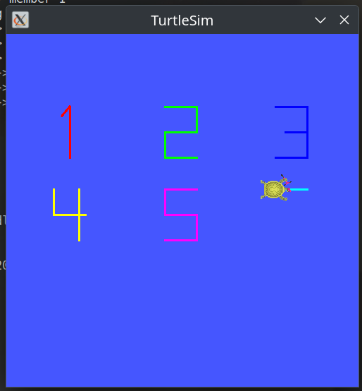
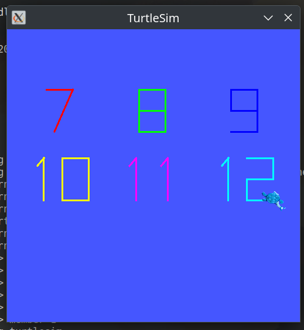
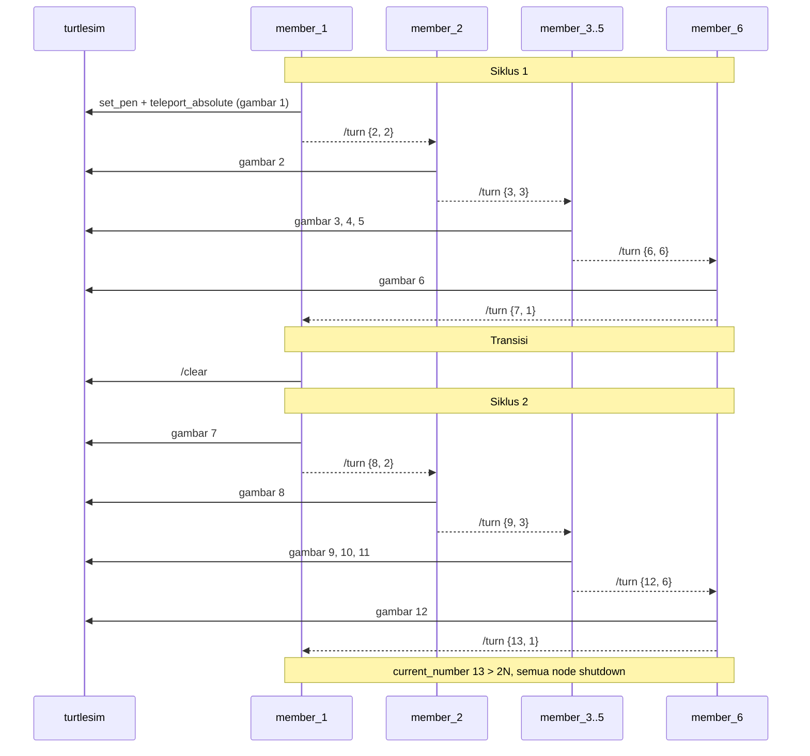
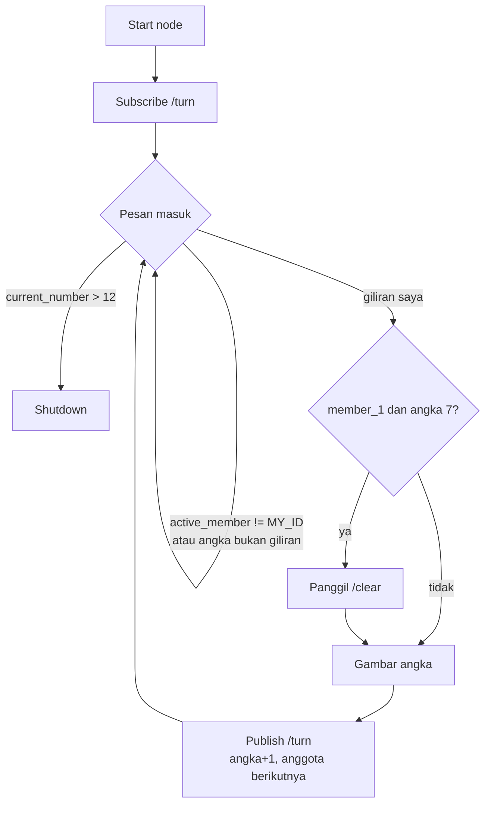

# Tugas Kelompok ROS2: Distributed Digit Relay (Turtlesim)

## Anggota Kelompok

| Nama | NRP |
|------|-----|
| Qurrata Ayun Kamil | 5025241031 |
| Muhammad Ryan Fikri Nugraha | 5025231013 |
| Cathleen Gracia | 5025231018 |
| Jalu Cahyo Senodiputro | 5025241155 |
| Raditya Zhafran Pranuja | 5025241120 |
| Erlangga Rizqi Dwi Raswanto | 5025241179 |

## Ringkasan

<p align="center">
  
  
</p>


Enam node ROS2 (`member_1` … `member_6`) bergantian menggambar angka **1–12** di `turtlesim`
memakai satu kura-kura (`turtle1`). Giliran dioper lewat topic `/turn` (tanpa delay hardcoded).
Setelah angka 6, `member_1` memanggil `/clear`, lalu siklus kedua menggambar 7–12. Setelah 12,
semua node berhenti sendiri.

## Struktur Repo

```
.
├── relay_interfaces/          # package pesan (ament_cmake)
│   └── msg/Turn.msg           # int32 current_number, int32 active_member
└── digit_relay/               # package node (ament_python)
    ├── digit_relay/member_1.py … member_6.py
    └── launch/relay.launch.py # turtlesim_node + 6 node anggota
```

| Node | Angka | Slot (x, y) | Warna pena (RGB) |
|------|-------|-------------|------------------|
| `member_1` | 1, 7  | (2.0, 8.0) | merah `255,0,0` |
| `member_2` | 2, 8  | (5.5, 8.0) | hijau `0,255,0` |
| `member_3` | 3, 9  | (9.0, 8.0) | biru `0,0,255` |
| `member_4` | 4, 10 | (2.0, 5.4) | kuning `255,255,0` |
| `member_5` | 5, 11 | (5.5, 5.4) | magenta `255,0,255` |
| `member_6` | 6, 12 | (9.0, 5.4) | cyan `0,255,255` |

Tiap angka digambar dalam kotak 1.0 × 1.6; angka 2 digit diberi jarak 0.2 antar digit dan
diletakkan di tengah slot, jadi tidak menabrak dinding atau slot lain.

## Cara Menjalankan

Kebutuhan: ROS2 (Humble/Jazzy) dengan package `turtlesim`.

1. Build dari root workspace, lalu source:
   ```bash
   cd ~/ros2_ws
   source /opt/ros/$ROS_DISTRO/setup.bash
   colcon build
   source install/setup.bash
   ```
3. Jalankan seluruh sistem dengan satu perintah:
   ```bash
   ros2 launch digit_relay relay.launch.py
   ```
4. Pantau giliran di terminal lain:
   ```bash
   source ~/ros2_ws/install/setup.bash
   ros2 topic echo /turn
   ```

Setiap kali kode diubah, ulangi langkah 2 sebelum launch.

## Alur Kerja

### Pesan giliran

Semua node publish dan subscribe ke topic `/turn` (`relay_interfaces/msg/Turn`) dengan QoS
`TRANSIENT_LOCAL`, depth 1. Artinya node yang start terlambat tetap menerima giliran terakhir.
Node hanya bergerak bila `active_member == MY_ID` dan `current_number` sesuai angka yang
ditunggunya; selain itu node diam (idle).

### Urutan



### Logika tiap node



`member_1` tidak menunggu pesan untuk angka 1: begitu service turtlesim siap, ia langsung
menggambar 1 dan memulai relay.

### Cara menggambar satu angka

Setiap digit adalah daftar polyline. Untuk tiap polyline:

1. `/turtle1/set_pen` dengan `off: 1` (pena diangkat).
2. `/turtle1/teleport_absolute` ke titik awal garis.
3. `/turtle1/set_pen` dengan `off: 0` (pena turun).
4. `teleport_absolute` ke titik-titik berikutnya, sehingga garis tergambar.

Pena diangkat lagi setelah angka selesai, jadi perpindahan antar slot tidak meninggalkan coretan.

---

## Soal Tugas

### 1. Deskripsi Tugas

Buatlah sebuah sistem terdistribusi multi-node pada ROS2 di mana setiap anggota kelompok mengontrol satu node independen untuk menggambar urutan angka yang terus bertambah (incrementing counter) secara bergantian di dalam `turtlesim`. Seluruh koordinasi giliran antar-node wajib berjalan otomatis menggunakan mekanisme komunikasi ROS2 (topic/service) tanpa intervensi manual atau hardcoded delay.

### 2. Alur Mekanisme & Siklus

Sistem akan berjalan tepat sebanyak **2 siklus penuh** sebelum berhenti otomatis:

* **Siklus 1 (Angka $1 \dots N$):**
  * Node Anggota 1 aktif, bergerak ke Slot 1, dan menggambar angka `1`.
  * Setelah selesai, Node Anggota 1 mengirimkan token/sinyal giliran ke Anggota 2 melalui ROS2.
  * Node Anggota 2 bergerak ke Slot 2, menggambar angka `2`, dan mengoper giliran ke anggota berikutnya.
  * ...proses berlanjut berurutan hingga Anggota $N$ menggambar angka $N$.
* **Transisi Siklus (Clear Canvas):**
  * Ketika Anggota $N$ selesai, giliran dikembalikan ke Anggota 1.
  * Sebelum memulai siklus kedua, Anggota 1 memanggil service `/clear` milik turtlesim untuk membersihkan kanvas.
* **Siklus 2 (Angka $(N+1) \dots 2N$):**
  * Anggota 1 menggambar angka $(N+1)$ di Slot 1.
  * Anggota 2 menggambar angka $(N+2)$ di Slot 2, berlanjut hingga Anggota $N$ selesai menggambar $2N$.
* **Terminasi / Selesai:**
  * Setelah Anggota $N$ menyelesaikan gambar di siklus 2, sistem harus berhenti secara anggun (graceful shutdown atau node masuk ke state idle).

### 3. Tata Letak Kanvas & Skala (Layout Constraint)

Kanvas turtlesim berukuran terbatas (koordinat sekitar $0.0$ hingga $11.0$):

* **Format Penempatan Bebas:** Tata letak penempatan angka **dibebaskan**, namun sangat disarankan menggunakan format **2 baris** (misal: baris atas untuk anggota 1–4/5, baris bawah untuk anggota berikutnya) atau **grid $3 \times 3$**.
* **Kerapian:** Angka **tidak boleh menabrak batas dinding kanvas** dan **tidak boleh tumpang tindih (overlap)**, terutama saat memasuki angka 2 digit pada Siklus 2. Mahasiswa diperbolehkan menyesuaikan kecepatan gerak, durasi, atau scaling koordinat masing-masing node.

### 4. Ketentuan Teknis

1. **Pembagian Workload:** Git commit history harus mencerminkan kontribusi masing-masing anggota.
2. **Sinkronisasi Giliran:** Node berkomunikasi melalui topic dengan pesan yang mencakup minimal status giliran:
   * `current_number` (int)
   * `active_member` (int)

   Node harus tetap berada dalam kondisi diam (idle) hingga gilirannya tiba.
3. **Manajemen Pena & Reset:**
   * Setiap anggota wajib menggunakan warna pena yang berbeda (atur via service `/turtle1/set_pen`).
   * Pena wajib diangkat (`off: 1`) saat kura-kura berpindah antar-posisi slot agar tidak meninggalkan coretan liar.
   * Penghapusan kanvas antar-siklus wajib menggunakan pemanggilan service `/clear`.
4. **Master Launch File:** Seluruh sistem (node `turtlesim_node` beserta seluruh node anggota) harus dapat dijalankan secara bersamaan hanya dengan **satu perintah launch**:
   ```bash
   ros2 launch <nama_package> relay.launch.py
   ```
